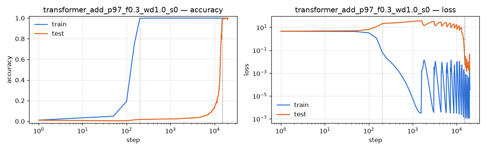

# grokking_experiments

Small, CPU-friendly grokking experiments on modular arithmetic (`a ∘ b mod p`).

## Layout

- `grokking/data.py`: datasets for `add`, `sub`, `mul`, `div` mod p, as `[a, op, b, =] -> c`
- `grokking/model.py`: a 1-layer transformer (Nanda et al. style) and an MLP baseline
- `train.py`: full-batch AdamW training that logs train/test loss and accuracy to `runs/<name>/history.json`
- `plot.py`: draws accuracy and loss curves (log-x) for one or more runs

## Quick start

```bash
pip install -r requirements.txt
python train.py --op add --p 97 --train-frac 0.3 --steps 15000 --threads 6
python plot.py runs/transformer_add_p97_f0.3_wd1.0_s0 -o grok.png
```

Useful flags: `--model {transformer,mlp}`, `--wd` (weight decay is the main lever on
grokking speed), `--train-frac`, `--lr`, `--batch-size` (0 = full batch), `--stop-on-grok`.

## CPU notes

- Set `--threads` to the number of **physical** cores. On a 12-logical-core WSL machine,
  6 threads was fastest, and 12 was pathologically slow because of oversubscription.
- The transformer has no LayerNorm. An earlier version built on `nn.TransformerEncoderLayer`
  (pre-LN) memorized but did **not** grok within 15k steps. LayerNorm plus weight decay is known
  to stall grokking.
- The transformer computes Q, the attention output and the MLP only at the final position. With
  one layer this is exact and makes each step about 3.5x cheaper (about 0.038 s per full-batch step
  on 6 threads).

## Baseline result

`python train.py --op add --p 97 --train-frac 0.3 --steps 20000 --threads 6` (seed 0, 12.6 min):

- train accuracy ≥ 99% at step **200**
- test accuracy ≥ 99% at step **15,150** (still around 3% at step 3k, then a sharp jump between 12k and 15k)


