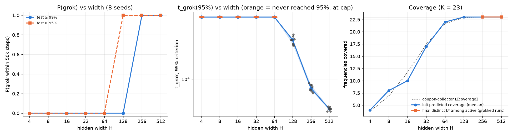
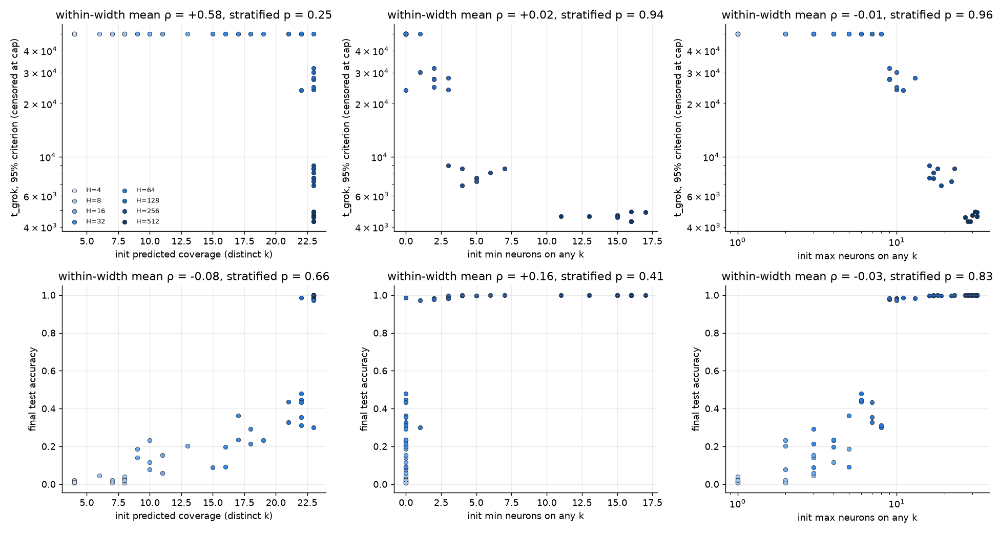
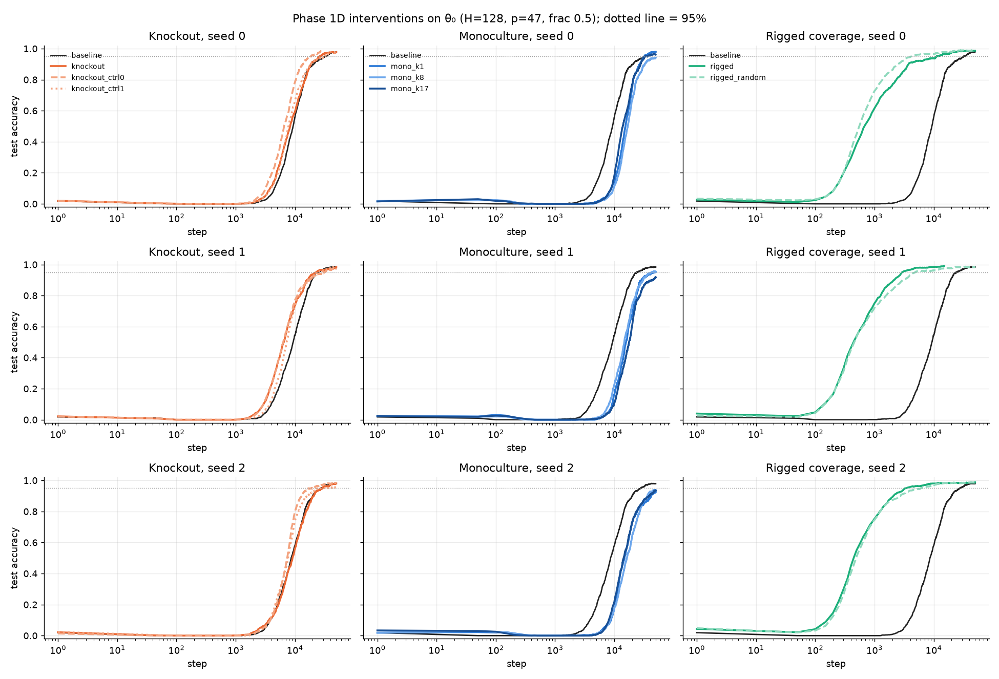
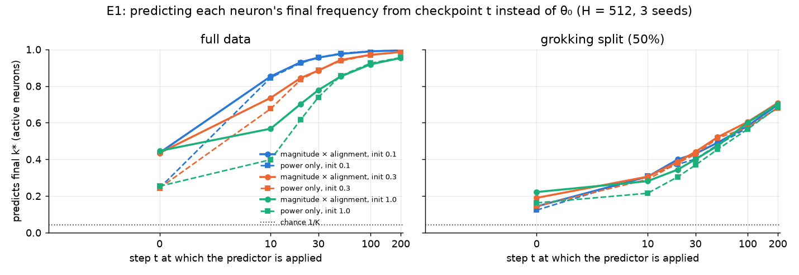
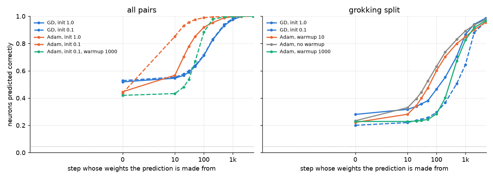
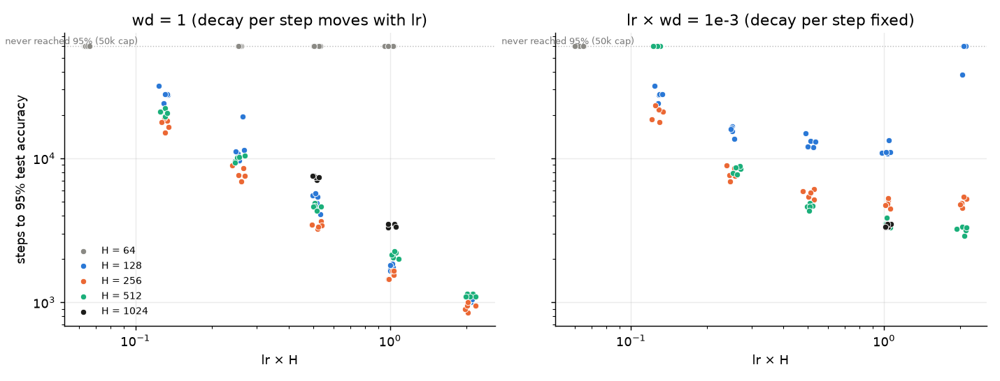
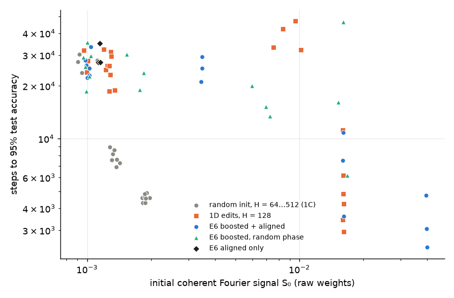

# Experiment 01 results: the frequency lottery and width

Status: **Phases 1A–1D done; 1E (follow-ups in `FOLLOWUPS.md`) done except E3 and E4.** The 1A–1D conclusion is
followed by Phase 1E, which revises two parts of it (marked *Revised in 1E*).

## Reproduce

```bash
python -m pytest -q tests                                              # Fourier unit tests
python experiments/01_frequency_lottery/phase1a_init_stats.py --p 47 --seeds 1000
bash   experiments/01_frequency_lottery/run_phase1b.sh 0.5 6           # 18 runs, 6 in parallel, about 30 min
python experiments/01_frequency_lottery/phase1b_analysis.py
bash   experiments/01_frequency_lottery/run_phase1c.sh 6 1.0           # 64 runs, 6 in parallel, about 15 min
python experiments/01_frequency_lottery/phase1c_analysis.py
python experiments/01_frequency_lottery/phase1d_interventions.py make --seeds 0 1 2
bash   experiments/01_frequency_lottery/run_phase1d.sh 6               # 27 runs, 6 in parallel, about 15 min
python experiments/01_frequency_lottery/phase1d_interventions.py analyze
# Phase 1E (E2, E5, E6, init vs split): about 260 runs, roughly 2.5 h with 11 in parallel
python experiments/01_frequency_lottery/phase1e_e6_rigged.py make
for a in e2cal e5 cf e6; do python experiments/01_frequency_lottery/phase1e_jobs.py $a > runs/exp01/phase1e/jobs_$a.txt; done
python experiments/01_frequency_lottery/phase1e_jobs.py e2 --gd-lr 1.0 > runs/exp01/phase1e/jobs_e2.txt
for a in e2cal e5 cf e2 e6; do bash experiments/01_frequency_lottery/run_phase1e.sh runs/exp01/phase1e/jobs_$a.txt 11; done
python experiments/01_frequency_lottery/phase1e_e1_predictor_over_time.py
python experiments/01_frequency_lottery/phase1e_e2_gd_warmup.py
python experiments/01_frequency_lottery/phase1e_e5_lr_width.py
python experiments/01_frequency_lottery/phase1e_cf_init_vs_split.py
python experiments/01_frequency_lottery/phase1e_e6_rigged.py analyze
python experiments/01_frequency_lottery/post_figures.py --out <dir>   # the blog post's figures
```

Raw runs go to `runs/exp01/` (gitignored). Summary plots and JSON go to `figures/`.

## Calibration: train-frac at p = 47 (H = 512, init scale 1.0, wd 1.0, lr 1e-3)

Pilot capped at 20k steps, using `--stop-on-grok`:

| train-frac | seed 0 test ≥ 99% | seed 1 test ≥ 99% |
|---|---|---|
| 0.3 | did not grok by 20k | did not grok by 20k |
| 0.4 | 17,900 | did not grok by 20k (97.7% test at 19k) |
| **0.5** | **5,250** | **5,850** |

**Frozen: `--train-frac 0.5`** (1,104 train / 1,105 test pairs). This is the smallest fraction in {0.3, 0.4, 0.5}
at which both pilot seeds grok in under 20k steps. At 0.4 only one seed made it, and narrower networks in 1C would
probably hit the cap. In every case train accuracy reaches 99% by step 150–200.

## Phase 1A: init-only statistics (p = 47, K = 23, 1,000 seeds per width)

The θ₀ for each seed is built with the same `make_model` call that `train.py` uses, so these statistics belong to
the actual networks trained in 1C. All three predictors are scale-invariant: they use Frobenius-normalized layers
and phases. So the statistics hold for every `--init-scale`. Full numbers: `figures/phase1a_summary.json`.
Per-network values: `runs/exp01/phase1a/init_stats.csv`.


- **The winners are uniform over k.** A χ² test on winners pooled over seeds finds no departure from uniform at any
  width, for any predictor (all p > 0.1). At H = 512 the largest relative deviation of any frequency from 1/K is
  under 1%. This is expected, because i.i.d. init makes the DFT bins k = 1..K exchangeable.
  
- **Coverage follows the coupon-collector curve exactly.** The mean number of distinct predicted frequencies matches
  `K(1 − (1 − 1/K)^H)` to within 0.1 at every width. Coverage is about 4 at H = 4, 12 at H = 16, 21.7 at H = 64,
  and all 23 frequencies from H = 128 on.
- **The minimum and maximum neurons per frequency match a uniform multinomial.** The minimum is 0 for H ≤ 64,
  about 1.6 at H = 128, 5.3 at 256, 13.6 at 512 and 32 at 1024. The maximum is about 4 at H = 32, 6.4 at 64,
  10.5 at 128 and 32 at 512.
  So the init-time "lottery" is statistically just i.i.d. uniform assignment. Within-width variation in 1C is the
  ordinary multinomial spread.
- **The two predictors mostly disagree.** `pred_power` and `pred_growth` agree on only **23%** of neurons, at every
  width, against 1/K ≈ 4.3% by chance. They are positively related but far from identical, so 1B can tell which
  criterion, if either, matters.
- **`pred_growth_pos` almost always equals `pred_growth`.** It differs only when cos D ≤ 0 at every k, which happened
  for 4 neurons in 128,000 at H = 128 and for none at any other width.

Implication for 1C: under hypothesis (A), coverage is complete at every H ≥ 128, so P(grok) and t_grok should stop
depending on coverage there. Any coverage effect has to show up between H = 16 and H = 64. Under (B), the relevant
init statistic is redundancy, which keeps growing roughly linearly in H.

## Phase 1B: does the lottery hold?

**Setup:** 18 runs: H = 512 × init scale {0.1, 0.3, 1.0} × {grokking split (frac 0.5), full data (frac 1.0)} ×
seeds {0, 1, 2}.
- **Checkpoints:** every 10 steps to step 500, every 250 to 5k, then every 1,000. *This deviates from the spec's
  schedule of 250 then 1,000.* A first pass on that grid showed that about 75% of neurons settle on their final k*
  before step 250, and t_fit is 100–200. The spec's grid therefore can't resolve lock-in. It also put the "k* at
  t_fit" reading at the init checkpoint, which made the switching fraction just 1 minus predictor accuracy.
- **Training lengths:** grokking runs continue 30k steps past t_grok. Full-data runs train for 20k steps.
- **Reruns are deterministic.** On one thread, every rerun hit exactly the same t_grok as the first pass.

Numbers below are for active neurons, pooled over 3 seeds (about 430–480 per run). Full data:
`figures/phase1b_results.json`.


| condition | pred_power | **pred_growth** | growth top-3 | switch t_fit → t_grok | locked by t_fit / t_grok | t_grok (seeds 0, 1, 2) |
|---|---|---|---|---|---|---|
| full, init 0.1 | 0.24 | **0.44** | 0.65 | 0.00–0.02 | - | - |
| full, init 0.3 | 0.24 | **0.44** | 0.65 | 0.02–0.04 | - | - |
| full, init 1.0 | 0.25 | **0.45** | 0.65 | 0.05–0.06 | - | - |
| grok, init 0.1 | 0.12 | **0.14** | 0.29 | 0.27–0.34 | 66% / 95% | 4850, 5550, 5650 |
| grok, init 0.3 | 0.15 | **0.19** | 0.35 | 0.27–0.33 | 65% / 96% | 4800, 5650, 6050 |
| grok, init 1.0 | 0.16 | **0.22** | 0.41 | 0.28–0.35 | 65% / 96% | 5250, 5850, 6500 |

Chance is 1/K = 0.043, or 3/K = 0.13 for top-3. For full data, "switch" compares t_fit with the end of training.
`pred_growth_pos` is identical to `pred_growth` in every run.

1. **H1 holds, partly.** θ₀ predicts the final frequency well above chance: 10× chance with full data and 3–5× in
   the grokking split. The predictor is the paper's criterion, magnitude × phase alignment (`pred_growth`); raw power
   is much weaker. Even so, most neurons do *not* end on their predicted winner. Top-3 accuracy is only 0.65 with
   full data and 0.29–0.41 in the grokking split.
2. **The lottery is drawn almost immediately.** Lock-in is the step after which k* never changes.
   - With full data, its median is 10–20 steps, and 95%+ of neurons never switch after t_fit.
   - In the grokking split, the median is 80–90 steps. About 65% of active neurons are locked by t_fit (step 200) and
     about 96% by t_grok.
   - Despite this, the predictor tops out at 44%. The winner is decided in the first ~10 optimizer steps, which
     coincide with the LR warmup, by something other than the init-time growth score alone (see the Adam caveat
     below).

   
3. **Switching happens, and mostly in the grokking split.** About 30% of active neurons change k* between t_fit and
   t_grok, compared with ≤ 6% under full data. This is the paper's "perturbed lottery". Memorizing a 50% split
   reshuffles assignments in a way that fitting all the data does not. It is partial support for (C), but most
   neurons (about 70%) do keep the frequency they had at t_fit.
4. **The dynamics.** Phase alignment `R(φa+φb−ψ)` goes from about 0 to 0.95 *before* t_fit and to 1.00 by t_grok.
   IPR stays near its init value (about 0.06) through memorization, rises mainly between t_fit and t_grok (to about
   0.55), and keeps rising afterwards (0.83 after 30k more steps). Mean |sin D| falls monotonically from 0.63 to
   0.03.

   
5. **Sign check.** At each active neuron's k*, `φa + φb − ψ` concentrates completely (resultant length R = 1.00 in
   every final network), while `φa + φb + ψ` stays uniform (R ≤ 0.02). **D = φa + φb − ψ, as specified.**
6. **Surprise: there are no "key frequencies".** In every run, all 23 frequencies (22 in two full-data runs) pass the
   2% threshold. The contribution-weighted effective number of frequencies, 1/Σq_k², is **22.5–23.0 out of 23**,
   even 30k steps after grokking. Weight decay sharpens neurons (IPR goes up) but does not prune the *population*
   down to a few frequencies. This differs from the 3–6 key frequencies reported for transformers. Two consequences:
   - The spec's item 5 (are key frequencies over-represented among init winners?) is degenerate here, because
     every frequency is a key frequency.
   - The H = 512 MLP gives no support to (B) in its "few key frequencies" form. If anything it suggests the network
     wants every frequency covered, which is closer to (A). The width sweep is what can test that.
7. **Init scale: the opposite of the expected direction.** Smaller init makes θ₀ *less* predictive in the grokking
   split (0.14 at scale 0.1 vs 0.22 at 1.0) and makes no difference with full data. Grokking time is the same at
   every scale.
   - **Caveat:** the paper's analysis is gradient flow, while we train with AdamW. Adam's per-coordinate
     normalization makes the first updates about lr in size regardless of weight scale. At small init, those updates
     are large *relative* to θ₀ and wash out the init-time ranking. The predictor is scale-invariant, but the
     optimizer is not.
   - A plain GD or SGD arm would test whether the lottery is sharper under the optimizer the theory assumes.

**For 1C:** use init scale **1.0** (the default), since it is the most predictive scale and the spec says to pick
that one. No extra init-scale arm is needed.

## Phase 1C: width sweep

**Setup:** 64 runs: H ∈ {4, 8, 16, 32, 64, 128, 256, 512} × seeds 0–7, p = 47, frac 0.5, init scale 1.0, wd 1.0.
Runs stop 2k steps after test reaches 99%, with a cap of 50k steps. The init statistics for each run are recomputed
from the same `make_model(seed, H)` θ₀ the run trained from. Full data: `figures/phase1c_results.json`. Launcher:
`run_phase1c.sh`. Analysis: `phase1c_analysis.py`.



| H | P(test ≥ 95%) | median t_grok (95%) | P(test ≥ 99%) | median t_grok (99%) | fits train | median final test acc | init coverage (median) |
|---|---|---|---|---|---|---|---|
| 4–16 | 0 | - | 0 | - | 0/8 | 0.01–0.15 | 4–10 |
| 32 | 0 | - | 0 | - | 4/8 (steps 9.5k–23k) | 0.22 | 17 |
| 64 | 0 | - | 0 | - | 8/8 (step ~1.3k) | 0.39 | 22 |
| **128** | **1.0** | **27,600** | **0** | - | 8/8 (step ~600) | **0.98** | **23 (complete)** |
| 256 | 1.0 | 7,900 | 1.0 | 10,400 | 8/8 (step 300) | 1.00 | 23 |
| 512 | 1.0 | 4,600 | 1.0 | 5,500 | 8/8 (step 200) | 1.00 | 23 |

1. **There is a sharp width threshold between H = 64 and H = 128.**
   - At H ≤ 64, the network memorizes (from H = 64; H = 32 only partly) but plateaus at 30–48% test accuracy for
     all 50k steps.
   - At H = 128, every seed generalizes to 97–99% but plateaus *just below* 99%. The strict 99% criterion would
     score it "did not grok", so the 95% criterion is the informative one at the boundary.
   - Above the threshold, grokking time keeps falling steeply: 27.6k → 7.9k → 4.6k steps at 95% as H goes
     128 → 256 → 512. log₁₀(t_grok / t_fit) is about 1.5 at both 256 and 512.
2. **Coverage at init is not the binding constraint, so it doesn't explain the threshold.**
   - Init coverage is already complete (23/23) in every H = 128 seed, and it is 22/23 at H = 64. Yet H = 64 gets
     only 39% test accuracy.
   - Above H = 128, coverage is saturated, but t_grok still falls 6×.
   - Whatever width buys beyond H = 128, it isn't more frequencies. In its init-coverage form, (A) is ruled out as
     the explanation of the width effect.
3. **The key test: init statistics do not predict within-width variation.** For each width with between-seed
   variation, I tested whether the init-time statistics (distinct predicted frequencies, minimum and maximum neurons
   per frequency, under both the growth and power predictors) predict the run's outcome. Outcomes were t_grok at 99%,
   t_grok at 95%, and final test accuracy. The tests used Spearman ρ, with a width-stratified permutation test
   (10k permutations).
   - Every combined stratified p is ≥ 0.25.
   - One per-width cell stands out: at H = 64, init max-count vs test accuracy gives ρ = −0.94 (p < 0.01). That is
     the *opposite* sign from (B). It is one of roughly 100 per-width tests, so it is most likely a false positive.
   - **Power caveat:** with 8 seeds, the per-width tests can only detect |ρ| ≳ 0.7. The combined test is better but
     still modest.
   - Between-seed spread at fixed H is small (t_grok IQR about ±10% at 256 and 512), so there is little variance
     left for init to explain.

   
4. **The final structure does predict outcomes, in the direction of redundancy.** Across the capacity-limited widths
   (H ≤ 64), runs whose *final* networks concentrate on **fewer** frequencies, with **more** neurons each, reach higher
   test accuracy:
   - final distinct k*: mean within-width ρ = −0.46, stratified p = 0.003
   - neurons per key frequency: ρ = +0.37, p = 0.004
   - effective number of frequencies: ρ = −0.40, p = 0.003

   For example, H = 64 networks drop from 22 frequencies at init to 13–21 at the end, and those that keep fewer do
   better. This is descriptive, not causal: the concentration is a product of training, not of θ₀. But it favors (B),
   redundancy, over (A), coverage. Below the threshold, the network does better by giving up frequencies so it can
   stack neurons on the rest.

**What 1C says about (A), (B) and (C) so far:**
- **(A) in its init-coverage form is ruled out.** The threshold sits where coverage is already complete.
- **The init lottery doesn't affect run-level outcomes.** Seed-to-seed differences in θ₀ statistics explain nothing
  detectable, which is consistent with (C): the 1B switching makes the draw at init matter little.
- **(B) gets descriptive support:** a few neurons per frequency is the binding resource below the threshold.
- **Open question:** whether redundancy also drives the speedups *above* the threshold, or whether that is plain
  optimization or capacity (C). The 1D interventions at **H = 128**, which generalizes but slowly, are designed to
  test this causally.

## Phase 1D: interventions on θ₀ (H = 128, seeds 0–2)

**Setup:**
- **Width:** H = 128 is the narrowest width that generalizes (95% test at about 28k steps), so speedups and slowdowns
  are both visible.
- **Edits:** each seed's θ₀ is edited with `project_to_frequencies`, or a direct DFT edit for the rigged variants.
  Every row of W1 and column of W2 is then rescaled to its original norm. The DC bin and biases are untouched.
- **Retraining:** each edited θ₀ is retrained with `--init-from` on the *same* data split, capped at 50k steps.
- **Sanity check:** the unedited baseline reloaded through `--init-from` reproduces the 1C runs exactly (identical
  t95 and final test accuracy for all three seeds).
- Build and analysis: `phase1d_interventions.py`. Launcher: `run_phase1d.sh`. Numbers: `figures/phase1d_results.json`.

**One adaptation.** The spec's knockout removes "the seed's final key frequencies". In this setup every run uses all
23 (see 1B and 1C), so the knockout removes the seed's **top 5 frequencies by final contribution share** instead.
These hold only 28–30% of the contribution, against 22% under uniform use. Two controls remove 5 random frequencies
drawn from the rest.



| variant | t95 per seed (0, 1, 2) | final test acc | effective # freqs at end | note |
|---|---|---|---|---|
| baseline | 31,850 / 24,000 / 27,750 | 0.98 / 0.98 / 0.98 | 21–22 | identical to 1C |
| knockout (top 5) | 26,150 / 23,100 / 29,500 | 0.98 / 0.98 / 0.98 | 20–21 | knocked-out freqs regrow to a 12–14% share |
| knockout control 0 | 18,650 / 31,350 / 18,850 | 0.99 / 0.98 / 0.98 | 20–21 | |
| knockout control 1 | 32,300 / 24,700 / 26,100 | 0.97 / 0.99 / 0.96 | 21 | |
| mono k = 1 | 32,250 / 46,950 / never | 0.98 / 0.95 / 0.93 | 16–18 | |
| mono k = 8 | never / 42,350 / never | 0.94 / 0.95 / 0.94 | 16–18 | |
| mono k = 17 | 33,300 / never / never | 0.96 / 0.92 / 0.94 | 17–18 | |
| **rigged (round-robin)** | **11,200 / 2,950 / 3,450** | 0.99 / 0.99 / 0.99 | 22.7 | |
| **rigged (random assignment)** | **4,250 / 4,850 / 6,150** | 0.99 / 0.98 / 0.99 | 19–21 | |

"never" = did not reach 95% within 50k steps.

1. **Knockout has no effect.** Removing a seed's most-used frequencies from every neuron at init leaves t95 within
   the seed-to-seed range, and random knockouts behave the same. The removed frequencies are not lost: training
   **regrows** them to a 12–14% share of the final network, below their baseline 28–30% but well above zero. The
   frequencies a network ends up using are not fixed by θ₀. Removing them just reroutes the outcome.
2. **Monoculture slows grokking and caps it.**
   - Forcing every neuron onto a single frequency delays generalization in all 9 runs. Only 4 of 9 reach 95% within
     50k steps, against 3/3 for the baseline, and final accuracy is 0.92–0.98.
   - The network **re-diversifies**: by the end it uses 21–23 distinct frequencies, and the forced one keeps only a
     13–15% share.
   - One frequency is enough in principle, but in practice the network neither uses just one nor learns faster from
     one. Diversity helps the learning dynamics. That fits the "majority vote over many frequencies" picture and
     goes against the strong form of (B), which says redundancy on *any* small set suffices.
3. **Rigged coverage gives a large speedup, but it doesn't come from coverage.**
   - **The speedup:** boosting one aligned frequency per neuron (twice that neuron's largest init magnitude, with
     D = 0) cuts t95 from about 28k to about 3–11k steps. Test accuracy starts climbing by about step 100, so the
     long memorization plateau almost disappears.
   - **The control:** the *random*-assignment arm is just as fast (4.3–6.2k). It gets the same boost but multinomial
     coverage, with 1–2 neurons on the least-covered frequency against 5 in round-robin. Round-robin is not reliably
     better: it was faster on seeds 1–2 and slower on seed 0.
   - **The driver:** what matters is that neurons *start* as strong, phase-aligned single-frequency features. How
     those features are spread over frequencies matters very little.

## Conclusion: which of (A), (B) and (C) the evidence favors

**Mostly (C), with a twist.**
- **The draw at init is real but weak.** θ₀ predicts a neuron's final frequency at 3–10× chance (1B). Neurons commit
  within tens of steps, and about 30% of them switch between memorization and grokking.
- **Natural variation in the draw doesn't matter for outcomes.** Seed-to-seed differences in init coverage or
  redundancy don't predict grokking time or accuracy at any width (1C).
- **The specific winners are interchangeable.** Removing them at init changes nothing, because the network regrows
  them (1D knockout).
- **(A), coverage at init, is ruled out as the explanation of the width effect.** Coverage is already complete at
  H = 128, where grokking takes 28k steps, and t_grok keeps falling 6× from H = 128 to 512 with coverage saturated.
- **(B) holds only in a weak form.** Below the threshold, networks that concentrate more neurons on fewer
  frequencies generalize better (1C, descriptive). But networks never converge to a few key frequencies. They use
  essentially all 23 at every width that generalizes. And forcing a single frequency hurts (1D).
- **The twist: the init lottery's *mechanism* is causally powerful, even though its natural draw isn't.**
  Initializations with strong, phase-aligned Fourier features grok **5–9× faster** whether or not their coverage is
  balanced (1D rigged). Random init falls far short of that regime; its winning margins are tiny. So what decides
  grokking time is **how strong the Fourier features are at the start**, not which frequencies won or how many were
  covered. On this reading, width speeds grokking mainly by adding neurons per frequency, which raises the starting
  strength of the population-level Fourier signal. *Revised in 1E:* the width effect is not an effective-lr
  artifact (E5), but the population-level signal S₀ does not explain it either (E6).

**Surprises:**
1. The one-hot MLP uses all K frequencies, roughly uniformly, even 30k steps after grokking. *Revised in 1E:* this
   is what the analytic solution predicts for an untied one-hot MLP, so it is not actually surprising.
2. Smaller init made θ₀ *less* predictive (1B). *E1 suggested* that Adam's first ~10 steps redraw the lottery.
   *Revised in 1E:* on full data they don't (the outcome is the same under GD or a 1,000-step warmup in 81–82% of
   neurons); on the grokking split, a smaller init makes the outcome less tied to θ₀ (init-vs-split test).
3. H = 128 plateaus at 97–99% test accuracy, so the 99% criterion understates where the threshold is.

**Caveats:**
- There are only 3 seeds per intervention and 8 per width. The 1C null result can only rule out strong within-width
  correlations (|ρ| ≳ 0.5 combined).
- Everything here is at p = 47 with AdamW. The p = 97 confirmation, a plain-GD arm, and the optional tied/no-bias
  replication of arXiv 2602.16849 have not been run.
- Rigged inits change more than one thing at once: they raise per-neuron IPR, phase alignment and the
  population-level Fourier signal together. A dose–response on `boost`, and alignment-only and concentration-only
  variants, would separate these.

## Phase 1E (follow-ups; see `FOLLOWUPS.md`)

### E1: was the lottery drawn by Adam's first steps? (no new runs)

This applies the same predictors to the 1B checkpoints at step t instead of θ₀, scoring each against the final k*
of the final active neurons. Script: `phase1e_e1_predictor_over_time.py`. Numbers: `figures/phase1e_e1_results.json`.



| condition | t = 0 | 10 | 20 | 30 | 50 | 100 | 200 |
|---|---|---|---|---|---|---|---|
| full, init 0.1 | 0.44 | **0.85** | 0.93 | 0.96 | 0.98 | 0.99 | 1.00 |
| full, init 0.3 | 0.43 | 0.74 | **0.84** | 0.88 | 0.94 | 0.97 | 0.99 |
| full, init 1.0 | 0.45 | 0.57 | 0.70 | 0.78 | **0.85** | 0.92 | 0.95 |
| grok, init 0.1 | 0.14 | 0.31 | 0.40 | 0.43 | 0.49 | 0.58 | 0.70 |
| grok, init 0.3 | 0.19 | 0.31 | 0.39 | 0.44 | 0.52 | 0.60 | 0.71 |
| grok, init 1.0 | 0.22 | 0.28 | 0.34 | 0.40 | 0.47 | 0.60 | 0.70 |

These are `pred_growth` accuracies. `pred_power` catches up with it by t = 30. Bold marks the first step at or above 80%.

- **Full data: the predictor improves quickly once training starts.** Ten Adam steps after a 0.1-scale init, the
  predictor gets 85% of neurons right, against 44% at θ₀. *The original reading here, that Adam's first steps
  redraw the lottery so that θ₁₀ rather than θ₀ decides the winner, is wrong; see E2.* Same θ₀ and data with a
  1,000-step warmup, or with plain GD, gives the same final k* for 81–82% of neurons. θ₀ decides most of the
  outcome; the gradient-flow score captures about half of it, and gets better as the weights move toward their
  answer.
- **Grokking split: assignment happens gradually during memorization.** Accuracy climbs slowly, to about 70% by
  step 200, and is the same at every init scale. Here the frequency each neuron settles on is shaped by fitting the
  training set, not decided in the first few steps.

### E2: plain gradient descent, and the Adam warmup ablation (H = 512, seeds 0–2)

Script: `phase1e_e2_gd_warmup.py`. Numbers: `figures/phase1e_e2_results.json`.

**Calibration** (seed 0, all pairs, 20k steps, SGD without momentum, L2 = 1e-3/lr so the decay per step matches
AdamW's lr·wd): lr 0.03 and 0.1 make no progress at either init scale (loss stays at ln 47); lr 0.3 fits at init 1.0
only (step 14,350); **lr 1.0** fits at both (steps 1,550 and 2,250). All GD arms use lr 1.0 with no warmup.



`pred_growth` accuracy at checkpoint t against final k* (active neurons), lock-in and switching:

| condition | t = 0 | 10 | 50 | 100 | 200 | 1000 | lock median | switch fit→end | t_fit | t95 |
|---|---|---|---|---|---|---|---|---|---|---|
| GD, all pairs, init 1.0 | 0.52 | 0.55 | 0.63 | 0.71 | 0.83 | 0.98 | 100 | 0.00–0.01 | 1,500–1,550 | – |
| GD, all pairs, init 0.1 | 0.53 | 0.55 | 0.64 | 0.72 | 0.83 | 0.98 | 100 | 0.00 | 2,200–2,250 | – |
| Adam, all pairs, init 1.0 (1B) | 0.45 | 0.57 | 0.85 | 0.92 | 0.95 | 1.00 | 20 | 0.05–0.06 | 150 | – |
| Adam, all pairs, init 0.1, warmup 1 | 0.43 | 0.89 | 0.98 | 0.99 | 1.00 | 1.00 | 10 | 0.01 | 100 | – |
| Adam, all pairs, init 0.1, warmup 10 (1B) | 0.44 | 0.85 | 0.98 | 0.99 | 1.00 | 1.00 | 10 | 0.00–0.02 | 100 | – |
| Adam, all pairs, init 0.1, warmup 100 | 0.43 | 0.56 | 0.94 | 0.98 | 0.99 | 1.00 | 20 | 0.01–0.02 | 100 | – |
| Adam, all pairs, init 0.1, warmup 1000 | 0.42 | 0.43 | 0.67 | 0.88 | 0.98 | 1.00 | 50 | 0.01–0.02 | 250 | – |
| GD, split, init 1.0 | 0.28 | 0.32 | 0.38 | 0.47 | 0.55 | 0.87 | 210 | 0.13–0.16 | 1,000 | 32k / – / – |
| GD, split, init 0.1 | 0.20 | 0.22 | 0.26 | 0.30 | 0.37 | 0.64 | 750 | 0.11–0.16 | 1,750 | – / – / – |
| Adam, split, warmup 1 | 0.23 | 0.33 | 0.53 | 0.63 | 0.74 | 0.89 | 70 | 0.26–0.28 | 200 | 4.5k–4.8k |
| Adam, split, warmup 10 (1B) | 0.22 | 0.28 | 0.47 | 0.60 | 0.70 | 0.85 | 90 | 0.28–0.35 | 200 | 4.6k–4.9k |
| Adam, split, warmup 100 | 0.23 | 0.24 | 0.35 | 0.54 | 0.72 | 0.90 | 110 | 0.25–0.33 | 200–250 | 4.5k–5.0k |
| Adam, split, warmup 1000 | 0.23 | 0.23 | 0.24 | 0.28 | 0.40 | 0.83 | 350 | 0.33–0.37 | 600 | 4.9k–5.4k |

**Same θ₀ and data, one thing changed** (share of neurons active in both runs with the same final k*, 3 seeds
pooled; chance ≈ 0.04):

| all pairs | agree | grokking split | agree |
|---|---|---|---|
| init 0.1, warmup 1 vs 1000 | 0.81 | init 1.0, warmup 1 vs 1000 | 0.70 |
| init 0.1, warmup 10 vs 100 | 0.90 | init 1.0, warmup 10 vs 100 | 0.75 |
| init 0.1, Adam vs GD | 0.82 | init 1.0, Adam vs GD | 0.50 |
| init 1.0, Adam vs GD | 0.82 | init 0.1, Adam vs GD | 0.35 |

- **On full data, θ₀ decides most of the outcome, whatever the optimizer.** A 1,000-step warmup or a switch to GD
  leaves 81–82% of final frequencies unchanged. The gradient-flow score gets 52–53% under GD (its own optimizer)
  and 43–45% under Adam: better than chance by 10×, but it captures only about half of what θ₀ determines. The early
  climb of the predictor tracks how far the weights have moved (it shifts right with warmup), not a redraw.
- **On the grokking split, the optimizer's path matters.** Changing the warmup changes 16–33% of final frequencies, and GD vs
  Adam half of them. Switching (fit → end) stays at 25–37% under Adam for every warmup and is 11–16% under GD.
- **Warmup barely affects grokking time** (t95 4.5k–5.4k across warmup 1–1000), and lock-in moves later with longer
  warmup (median 70 → 350).
- **GD mostly doesn't grok within 50k steps** at lr 1.0 (1 of 6 runs reached 95%, at 32k), so the theory's own
  regime can't be tested on the split with this budget.
- Caveats: GD here is discrete (lr 1.0), with biases and untied one-hot inputs, not the tied/no-bias model of
  arXiv 2602.16849. 3 seeds.

### Init vs split: what decides a neuron's frequency on the grokking split?

θ₀ from seed i, data split from seed j, i, j ∈ {0, 1, 2}, stop 2k steps after 99% test (cap 50k). The diagonal runs
reproduce 1B/1C exactly (identical t95). Script: `phase1e_cf_init_vs_split.py`. Numbers:
`figures/phase1e_cf_results.json`.

| config | same θ₀, different split | chance | init score (pred_growth) | same k* under all 3 splits | √(same-θ₀ agreement) |
|---|---|---|---|---|---|
| H = 128, init 1.0 | 0.137 | 0.044 | 0.200 | 5.0% | 0.37 |
| H = 256, init 1.0 | 0.147 | 0.044 | 0.233 | 5.1% | 0.38 |
| H = 512, init 1.0 | 0.162 | 0.043 | 0.233 | 5.9% | 0.40 |
| H = 512, init 0.3 | 0.127 | 0.044 | 0.197 | 4.0% | 0.36 |
| H = 512, init 0.1 | 0.093 | 0.044 | 0.161 | 2.1% | 0.30 |

- **θ₀ fixes only 9–16% of assignments on the grokking split** (chance 4.4%), at every width. Changing which half of
  the pairs is held out reassigns the rest. A smaller init makes the outcome even less tied to θ₀.
- **An init-only predictor is capped.** If a predictor is right for a neuron with probability q under each split
  independently, the same-θ₀ agreement is at least about q², so q ≲ √(agreement) ≈ 30–40%. The paper's score reaches
  16–23%, about half the cap. Of the few neurons that keep their frequency under all three splits, the score names it
  57–79% of the time.
- **"Same split, different θ₀" is at chance (0.040–0.045) by construction:** neuron m has no identity across
  different inits. *This corrects a reading of the pilot, which took it as evidence that the split matters more than
  the init.* The fair split-level comparison, the correlation of per-frequency contribution shares between runs, is
  weak and noisy everywhere (≤ 0.24 with 23 near-uniform shares and 9 pairs per cell), so whether the split shapes
  *which* frequencies dominate is unresolved.
- **t95 doesn't depend on θ₀ or on the split much:** the variance of log t95 across the 3×3 grid is small (e.g.
  4.4k–4.9k at H = 512, init 1.0), with neither the row (init) nor the column (split) effect dominating.

### E5: is the width effect just effective learning rate? (H ∈ {64, 128, 256, 512, 1024}, 5 seeds)

Arm (a): wd = 1, so the decay per step lr·wd moves with lr. Arm (b): lr·wd = 1e-3 held fixed. Grid: lr·H ∈ {0.128,
0.256, 0.512, 1.024, 2.048} for H = 128, 256, 512 in both arms, plus H = 64 at lr {4, 8, 16}e-3 and H = 1024 at lr
{0.5, 1}e-3 (wd 1). The lr 1e-3, wd 1 cells are the 1C runs (seeds 0–4). 50k cap. Script: `phase1e_e5_lr_width.py`.
Numbers: `figures/phase1e_e5_results.json`.



Median t95 (all 5 seeds reach 95% unless noted):

| H | arm (a) wd = 1: lr 2.5e-4 / 5e-4 / 1e-3 / 2e-3 / 4e-3 / 8e-3 / 1.6e-2 | arm (b) lr·wd = 1e-3: same lr grid |
|---|---|---|
| 128 | – / – / 27.8k / 11.1k / 5.4k / 1.75k / 1.05k | – / – / 27.8k / 15.9k / 13.1k / 11.1k / 1 of 5 |
| 256 | – / 17.9k / 7.6k / 3.4k / 1.55k / 0.95k / – | – / 21.0k / 7.6k / 5.8k / 4.9k / 4.9k / – |
| 512 | 21.1k / 10.2k / 4.6k / 2.15k / 1.1k / – / – | 0 of 5 (wd 4) / 8.5k / 4.6k / 3.55k / 3.25k / – / – |
| 1024 | – / 7.4k / 3.35k / – / – / – / – | |
| 64 | never reaches 95% at lr 1e-3 … 1.6e-2; final test rises from 0.30–0.48 to 0.77–0.89 | |

Log-linear fits over the 136 runs with H ≥ 128 that reach 95% (coefficient ± s.e.):

| model | R² | lr | H | lr·wd |
|---|---|---|---|---|
| log t95 ~ log(lr·H) | 0.66 | −0.85 ± 0.05 (shared) | | |
| ~ log lr + log H | 0.67 | −0.84 ± 0.05 | −0.99 ± 0.09 | |
| ~ log lr + log H + log(lr·wd) | **0.92** | −0.36 ± 0.03 | **−1.03 ± 0.04** | **−0.78 ± 0.04** |
| arm (a) only: ~ log lr + log H | 0.95 | −1.11 ± 0.03 | −0.98 ± 0.04 | |
| arm (b) only: ~ log lr + log H | 0.82 | −0.40 ± 0.04 | −1.06 ± 0.06 | |

- **The width effect is not an effective-lr artifact.** With the decay per step fixed (arm b), raising lr 8× speeds
  H = 128 up only 2.5× and it never reaches H = 512's speed; H = 512 is 4–6× faster than H = 128 at every lr.
  t95 ∝ H^−1 in both arms.
- **The apparent lr·H collapse in arm (a) is a coincidence of exponents.** At wd = 1, raising lr also raises lr·wd,
  and the two together give lr^−1.1, close to H's −1.0. *This corrects the pilot reading (2 seeds, arm a only) that
  the 128→512 speed-up is "matched by scaling the learning rate".*
- **Decay per step is the other big lever** (exponent −0.8), consistent with weight decay setting the grokking
  timescale. Too much decay breaks it (H = 512, lr 2.5e-4, wd 4: test plateaus at 0.79–0.84), and too little at a
  high lr too (H = 128, lr 1.6e-2, wd 0.0625: 1 of 5 reach 95%).
- **The width gain flattens above 512:** at lr 1e-3, H = 1024 is 1.4× faster than 512, and at matched lr·H it is
  slower. From 128 to 256 the gain is 3.6×, from 256 to 512 1.7×.
- **The threshold is not an lr effect:** H = 64 never reaches 95% even at 16× lr, though its plateau rises.
- The μP arm of E5 (per-layer lr and init scaling) was not run; arm (b) answers the confound question without it.

### E6: rigged init, dose-response and decomposition (H = 128, seeds 0–2, 1C splits)

Random assignment k_m ~ U{1..K}; rows rescaled to their original norm as in 1D. Script: `phase1e_e6_rigged.py`.
Numbers: `figures/phase1e_e6_results.json`.

| variant | t95 (seeds 0 / 1 / 2) | S₀ (mean) |
|---|---|---|
| baseline (1C) | 31.9k / 24.0k / 27.8k | 0.0010 |
| boost 0.25, aligned | 26.3k / 23.0k / 33.5k | 0.0010 |
| boost 0.5, aligned | 28.1k / 22.3k / 25.3k | 0.0010 |
| boost 1, aligned | 25.2k / 29.4k / 21.1k | 0.0035 |
| boost 2, aligned | **10.8k / 3.6k / 7.5k** | 0.016 |
| boost 4, aligned | **3.1k / 2.4k / 4.8k** | 0.040 |
| boost 0.25, random output phase | 18.7k / 22.7k / 29.7k | 0.0010 |
| boost 0.5, random output phase | 29.1k / 25.8k / 35.6k | 0.0010 |
| boost 1, random output phase | 23.8k / 30.4k / 19.0k | 0.0017 |
| boost 2, random output phase | 13.5k / 20.1k / 15.2k | 0.0067 |
| boost 4, random output phase | 16.2k / 6.2k / 46.3k | 0.016 |
| alignment only (no boost) | 27.3k / 27.3k / 34.9k | 0.0011 |



- **A threshold in the boost:** nothing happens until the assigned frequency is clearly the neuron's largest
  component (boost > 1). At boost 1 it only ties, and the runs are as slow as unedited ones.
- **Both concentration and alignment are needed.** Alignment alone does nothing: the `pred_growth` winner already
  has mean cos D ≈ 0.85 at random init. A 2× boost with a random output phase speeds grokking ~1.8× (median); aligned,
  ~3.7×; at 4×, aligned is ~9× and reliable while random-phase is erratic (6k–46k).
- **S₀ does not unify width and rigging.** Within H = 128 (1D + E6 + baseline, 63 runs), log t95 vs log S₀ has slope
  −0.44, R² 0.54. Across the 1C widths it has slope −2.7 (R² 0.92): a 2× rise in S₀ from H = 128 to 512 goes with a
  6× speed-up, while rigging needs a ~16× rise for a similar effect. Pooled, R² 0.23. Width acts through something
  other than the initial coherent signal.

### Phase 1E conclusion

- **The lottery picture holds better on full data than the 1B numbers suggested, and worse on the grokking split.**
  On full data θ₀ determines ~80% of the final assignment, robustly to the optimizer; the gradient-flow score sees
  about half of that. On the grokking split θ₀ determines 9–16%; the held-out set and the optimizer path decide the
  rest.
- **Width is a real lever** (t95 ∝ H^−1 from 128 to 512 at a fixed decay per step), not an effective-lr artifact, and
  not explained by S₀. Decay per step is nearly as strong a lever.
- **The rigged-init speed-up needs a dominant, phase-aligned frequency per neuron.** Neither ingredient works alone.
- Open: E3 (does the threshold scale with K?), E4 (embedding bottleneck), and a GD replication long enough to grok,
  ideally in the tied/no-bias architecture of arXiv 2602.16849.

### Reframing "no key frequencies"

The 1B/1C finding that the network uses all 23 frequencies is what the theory for this architecture predicts, so it
isn't a surprise:
- **Gromov 2023 (arXiv 2301.02679):** the analytic solution assigns one frequency per neuron, with k running over
  the full set up to (p−1)/2. With more neurons than frequencies, "each frequency appears several times with
  different random phases", and extra width "introduces redundancy" rather than new features.
- **arXiv 2602.16849:** the frequency-diversification condition likewise needs the neurons to cover the spectrum.

The 3–6 key frequencies reported for transformers more likely come from the shared, weight-decayed embedding
bottleneck. That is a hypothesis; E4 tests it.

## Infrastructure notes

- `grokking/model.py`: new `--d-hidden`, `--init-scale`, `--no-bias` and `--mlp-input tied`. `make_model(...)` is
  now the single place a seed's θ₀ is built.
- `train.py`: new `--optim {adamw,sgd}` (1E; `sgd` is plain full-batch GD without momentum, `--wd` as L2 decay;
  the default `adamw` path is unchanged, and the 1E diagonal runs reproduce 1B/1C t95 exactly), `--save-init`, `--ckpt-every` (with `--ckpt-dense-until/--ckpt-dense-every` and
  `--ckpt-sparse-after/--ckpt-sparse-every` for a 10 → 250 → 1000 schedule), `--init-from`, `--mask`, `--max-steps` (an alias of `--steps`) and `--post-grok-steps`. Every run also
  saves `final.pt`. The summary now includes `train/test_{95,99}_step`, `grok_ratio`, `log10_grok_ratio` and the
  same ratios at 95%. With `--train-frac 1.0` the test metrics are NaN.
- **Defaults are unchanged.** Rerunning the original one-hot p = 97 baseline for 1,000 steps reproduces the old
  history bit for bit (the maximum difference in losses and accuracies is 0.0).
- `grokking/fourier.py` implements every quantity in the spec. `tests/test_fourier.py` checks recovery of magnitude,
  phase, k* and IPR = 1 on synthetic cosines, plus `project_to_frequencies`, the active set and key frequencies.
