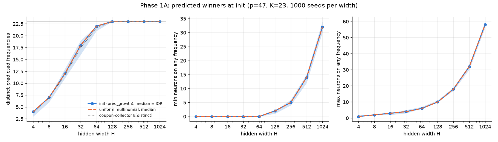
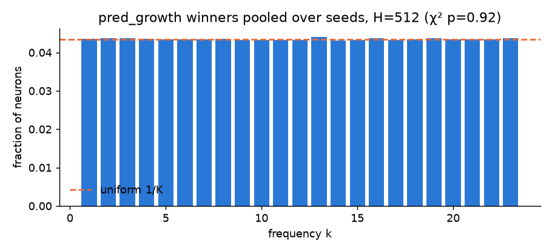
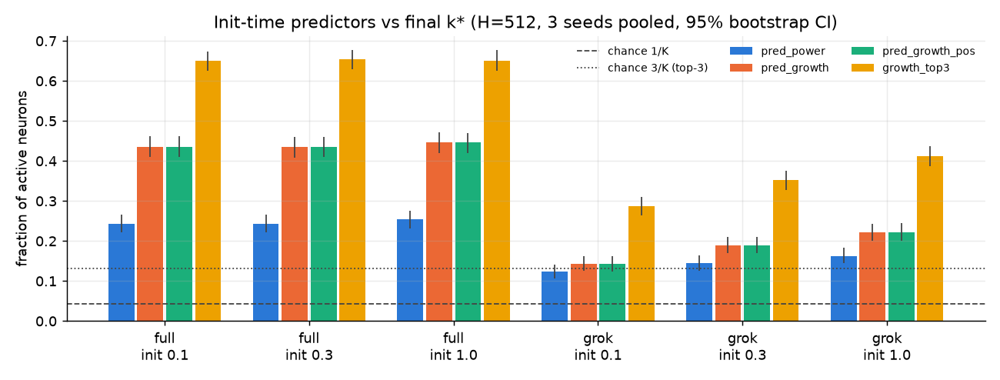
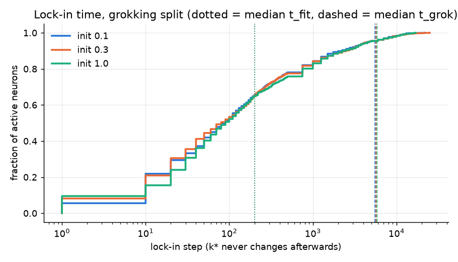
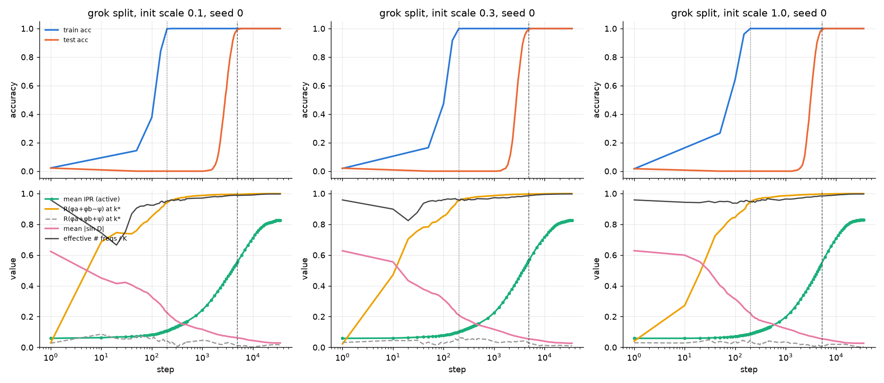

# Experiment 01 results: the frequency lottery and width

Status: **in progress.** Shared infrastructure, calibration, Phase 1A and Phase 1B are done.
Phases 1C and 1D have not started.

## Reproduce

```bash
python -m pytest -q tests                                              # Fourier unit tests
python experiments/01_frequency_lottery/phase1a_init_stats.py --p 47 --seeds 1000
bash   experiments/01_frequency_lottery/run_phase1b.sh 0.5 6           # 18 runs, 6 in parallel, about 30 min
python experiments/01_frequency_lottery/phase1b_analysis.py
```

Raw runs go to `runs/exp01/` (gitignored). Summary plots and JSON go to `figures/`.

## Calibration: train-frac at p = 47 (H = 512, init scale 1.0, wd 1.0, lr 1e-3)

Pilot capped at 20k steps, using `--stop-on-grok`:

| train-frac | seed 0 test ≥ 99% | seed 1 test ≥ 99% |
|---|---|---|
| 0.3 | did not grok by 20k | did not grok by 20k |
| 0.4 | 17,900 | did not grok by 20k (97.7% test at 19k) |
| **0.5** | **5,250** | **5,850** |

**Frozen: `--train-frac 0.5`** (1,104 train / 1,105 test pairs). This is the smallest fraction in {0.3, 0.4, 0.5}
at which both pilot seeds grok in under 20k steps. At 0.4 only one seed made it, and narrower networks in 1C would
probably hit the cap. In every case train accuracy reaches 99% by step 150–200.

## Phase 1A: init-only statistics (p = 47, K = 23, 1,000 seeds per width)

The θ₀ for each seed is built with the same `make_model` call that `train.py` uses, so these statistics belong to
the actual networks trained in 1C. All three predictors are scale-invariant: they use Frobenius-normalized layers
and phases. So the statistics hold for every `--init-scale`. Full numbers: `figures/phase1a_summary.json`.
Per-network values: `runs/exp01/phase1a/init_stats.csv`.



- **The winners are uniform over k.** A χ² test on winners pooled over seeds finds no departure from uniform at any
  width, for any predictor (all p > 0.1). At H = 512 the largest relative deviation of any frequency from 1/K is
  under 1%. This is expected, because i.i.d. init makes the DFT bins k = 1..K exchangeable.
  
- **Coverage follows the coupon-collector curve exactly.** The mean number of distinct predicted frequencies matches
  `K(1 − (1 − 1/K)^H)` to within 0.1 at every width. Coverage is about 4 at H = 4, 12 at H = 16, 21.7 at H = 64,
  and all 23 frequencies from H = 128 on.
- **The minimum and maximum neurons per frequency match a uniform multinomial.** The minimum is 0 for H ≤ 64,
  about 1.6 at H = 128, 5.3 at 256, 13.6 at 512 and 32 at 1024. The maximum is about 4 at H = 32, 6.4 at 64,
  10.5 at 128 and 32 at 512.
  So the init-time "lottery" is statistically just i.i.d. uniform assignment. Within-width variation in 1C is the
  ordinary multinomial spread.
- **The two predictors mostly disagree.** `pred_power` and `pred_growth` agree on only **23%** of neurons, at every
  width, against 1/K ≈ 4.3% by chance. They are positively related but far from identical, so 1B can tell which
  criterion, if either, matters.
- **`pred_growth_pos` almost always equals `pred_growth`.** It differs only when cos D ≤ 0 at every k, which happened
  for 4 neurons in 128,000 at H = 128 and for none at any other width.

Implication for 1C: under hypothesis (A), coverage is complete at every H ≥ 128, so P(grok) and t_grok should stop
depending on coverage there. Any coverage effect has to show up between H = 16 and H = 64. Under (B), the relevant
init statistic is redundancy, which keeps growing roughly linearly in H.

## Phase 1B: does the lottery hold?

**Setup:** 18 runs: H = 512 × init scale {0.1, 0.3, 1.0} × {grokking split (frac 0.5), full data (frac 1.0)} ×
seeds {0, 1, 2}.
- **Checkpoints:** every 10 steps to step 500, every 250 to 5k, then every 1,000. *This deviates from the spec's
  schedule of 250 then 1,000.* A first pass on that grid showed that about 75% of neurons settle on their final k*
  before step 250, and t_fit is 100–200. The spec's grid therefore can't resolve lock-in. It also put the "k* at
  t_fit" reading at the init checkpoint, which made the switching fraction just 1 minus predictor accuracy.
- **Training lengths:** grokking runs continue 30k steps past t_grok. Full-data runs train for 20k steps.
- **Reruns are deterministic.** On one thread, every rerun hit exactly the same t_grok as the first pass.

Numbers below are for active neurons, pooled over 3 seeds (about 430–480 per run). Full data:
`figures/phase1b_results.json`.



| condition | pred_power | **pred_growth** | growth top-3 | switch t_fit → t_grok | locked by t_fit / t_grok | t_grok (seeds 0, 1, 2) |
|---|---|---|---|---|---|---|
| full, init 0.1 | 0.24 | **0.44** | 0.65 | 0.00–0.02 | - | - |
| full, init 0.3 | 0.24 | **0.44** | 0.65 | 0.02–0.04 | - | - |
| full, init 1.0 | 0.25 | **0.45** | 0.65 | 0.05–0.06 | - | - |
| grok, init 0.1 | 0.12 | **0.14** | 0.29 | 0.27–0.34 | 66% / 95% | 4850, 5550, 5650 |
| grok, init 0.3 | 0.15 | **0.19** | 0.35 | 0.27–0.33 | 65% / 96% | 4800, 5650, 6050 |
| grok, init 1.0 | 0.16 | **0.22** | 0.41 | 0.28–0.35 | 65% / 96% | 5250, 5850, 6500 |

Chance is 1/K = 0.043, or 3/K = 0.13 for top-3. For full data, "switch" compares t_fit with the end of training.
`pred_growth_pos` is identical to `pred_growth` in every run.

1. **H1 holds, partly.** θ₀ predicts the final frequency well above chance: 10× chance with full data and 3–5× in
   the grokking split. The predictor is the paper's criterion, magnitude × phase alignment (`pred_growth`); raw power
   is much weaker. Even so, most neurons do *not* end on their predicted winner. Top-3 accuracy is only 0.65 with
   full data and 0.29–0.41 in the grokking split.
2. **The lottery is drawn almost immediately.** Lock-in is the step after which k* never changes.
   - With full data, its median is 10–20 steps, and 95%+ of neurons never switch after t_fit.
   - In the grokking split, the median is 80–90 steps. About 65% of active neurons are locked by t_fit (step 200) and
     about 96% by t_grok.
   - Despite this, the predictor tops out at 44%. The winner is decided in the first ~10 optimizer steps, which
     coincide with the LR warmup, by something other than the init-time growth score alone (see the Adam caveat
     below).

   
3. **Switching happens, and mostly in the grokking split.** About 30% of active neurons change k* between t_fit and
   t_grok, compared with ≤ 6% under full data. This is the paper's "perturbed lottery". Memorizing a 50% split
   reshuffles assignments in a way that fitting all the data does not. It is partial support for (C), but most
   neurons (about 70%) do keep the frequency they had at t_fit.
4. **The dynamics.** Phase alignment `R(φa+φb−ψ)` goes from about 0 to 0.95 *before* t_fit and to 1.00 by t_grok.
   IPR stays near its init value (about 0.06) through memorization, rises mainly between t_fit and t_grok (to about
   0.55), and keeps rising afterwards (0.83 after 30k more steps). Mean |sin D| falls monotonically from 0.63 to
   0.03.

   
5. **Sign check.** At each active neuron's k*, `φa + φb − ψ` concentrates completely (resultant length R = 1.00 in
   every final network), while `φa + φb + ψ` stays uniform (R ≤ 0.02). **D = φa + φb − ψ, as specified.**
6. **Surprise: there are no "key frequencies".** In every run, all 23 frequencies (22 in two full-data runs) pass the
   2% threshold. The contribution-weighted effective number of frequencies, 1/Σq_k², is **22.5–23.0 out of 23**,
   even 30k steps after grokking. Weight decay sharpens neurons (IPR goes up) but does not prune the *population*
   down to a few frequencies. This differs from the 3–6 key frequencies reported for transformers. Two consequences:
   - The spec's item 5 (are key frequencies over-represented among init winners?) is degenerate here, because
     every frequency is a key frequency.
   - The H = 512 MLP gives no support to (B) in its "few key frequencies" form. If anything it suggests the network
     wants every frequency covered, which is closer to (A). The width sweep is what can test that.
7. **Init scale: the opposite of the expected direction.** Smaller init makes θ₀ *less* predictive in the grokking
   split (0.14 at scale 0.1 vs 0.22 at 1.0) and makes no difference with full data. Grokking time is the same at
   every scale.
   - **Caveat:** the paper's analysis is gradient flow, while we train with AdamW. Adam's per-coordinate
     normalization makes the first updates about lr in size regardless of weight scale. At small init, those updates
     are large *relative* to θ₀ and wash out the init-time ranking. The predictor is scale-invariant, but the
     optimizer is not.
   - A plain GD or SGD arm would test whether the lottery is sharper under the optimizer the theory assumes.

**For 1C:** use init scale **1.0** (the default), since it is the most predictive scale and the spec says to pick
that one. No extra init-scale arm is needed.

## Infrastructure notes

- `grokking/model.py`: new `--d-hidden`, `--init-scale`, `--no-bias` and `--mlp-input tied`. `make_model(...)` is
  now the single place a seed's θ₀ is built.
- `train.py`: new `--save-init`, `--ckpt-every` (with `--ckpt-dense-until/--ckpt-dense-every` and
  `--ckpt-sparse-after/--ckpt-sparse-every` for a 10 → 250 → 1000 schedule), `--init-from`, `--mask`, `--max-steps` (an alias of `--steps`) and `--post-grok-steps`. Every run also
  saves `final.pt`. The summary now includes `train/test_{95,99}_step`, `grok_ratio`, `log10_grok_ratio` and the
  same ratios at 95%. With `--train-frac 1.0` the test metrics are NaN.
- **Defaults are unchanged.** Rerunning the original one-hot p = 97 baseline for 1,000 steps reproduces the old
  history bit for bit (the maximum difference in losses and accuracies is 0.0).
- `grokking/fourier.py` implements every quantity in the spec. `tests/test_fourier.py` checks recovery of magnitude,
  phase, k* and IPR = 1 on synthetic cosines, plus `project_to_frequencies`, the active set and key frequencies.
